# sesi_pbe1_aula09_eventos_climaticos_2026 - Atividade de backend
## Objetivo
Conectar o back-end da aplicação web com um banco de dados relacional, utilizando o SGBD MariaDB e a linguagem de programação JavaScript com Node.js.
#### Documentação

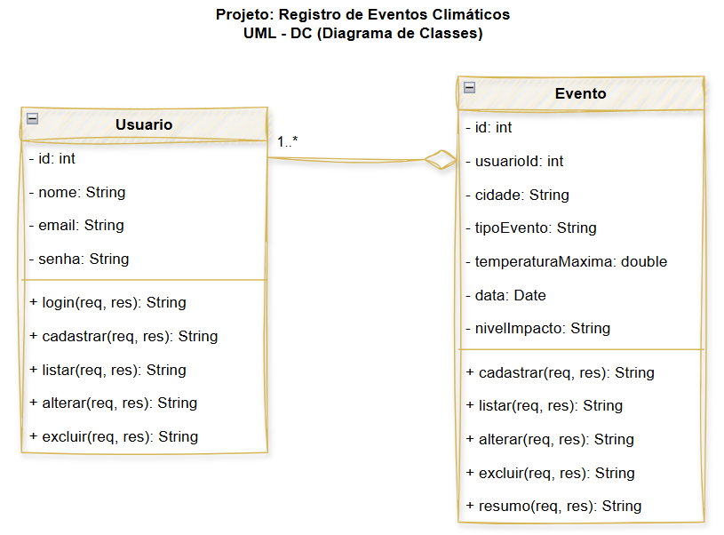
#### Tecnologias utilizadas
- SGBD: Sistema de Gerenciamento de Banco de Dados
- MariaDB: Sistema de Gerenciamento de Banco de Dados relacional, derivado do MySQL.
- Node.js: Ambiente de execução JavaScript, que permite a execução de código JavaScript fora do navegador.
#### Realizar teste unitário com o Thunder Client
- Instale a extensão **Thunder Client** no VS Code.
- Abra o Thunder Client e crie uma nova requisição POST para cadastrar um usuário:
    - URL: `http://localhost:3000/usuarios`
    - Body (JSON):
```json
{
    "nome": "Carlos Pereira",
    "email": "carlos.pereira@example.com",
    "senha": "senha123"
}
```
- Clique em **Send** e verifique se o usuário foi cadastrado com sucesso.
- Crie uma nova requisição GET para listar todos os usuários:  
    - URL: `http://localhost:3000/usuarios`
- Clique em **Send** e verifique se a lista de usuários é retornada corretamente.
## Prints dos testes de cadastrar usuário
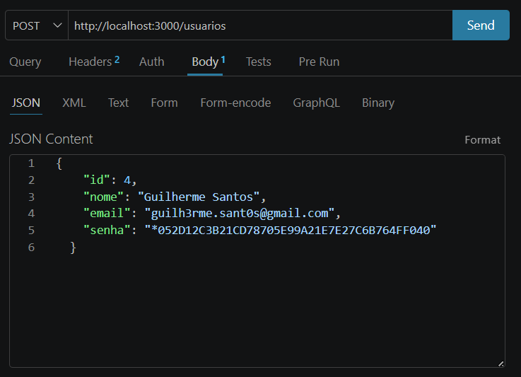
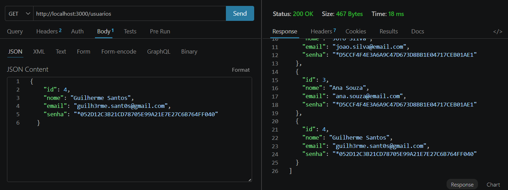
## Prints dos testes de cadastrar evento
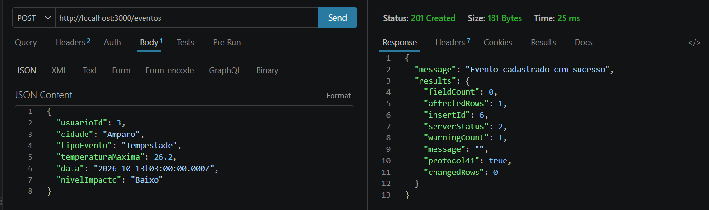
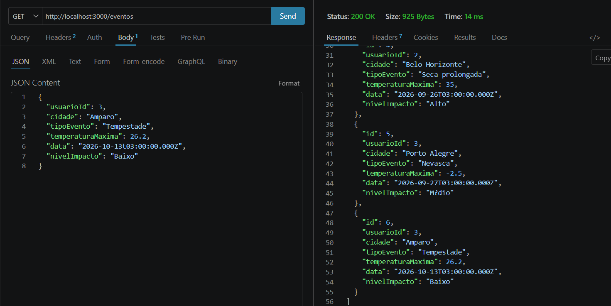
## Prints dos testes de listar
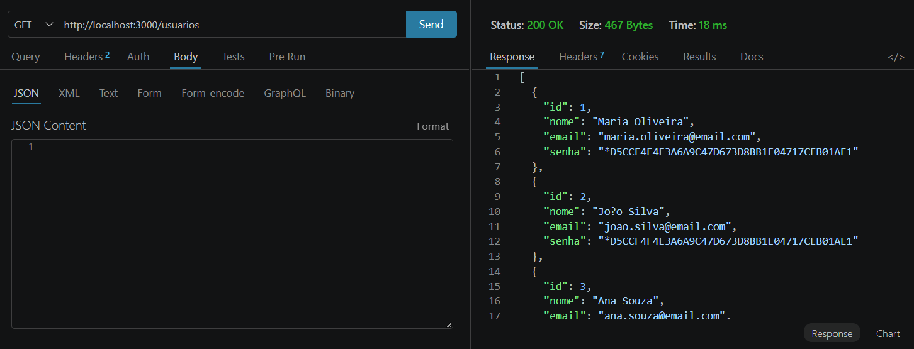
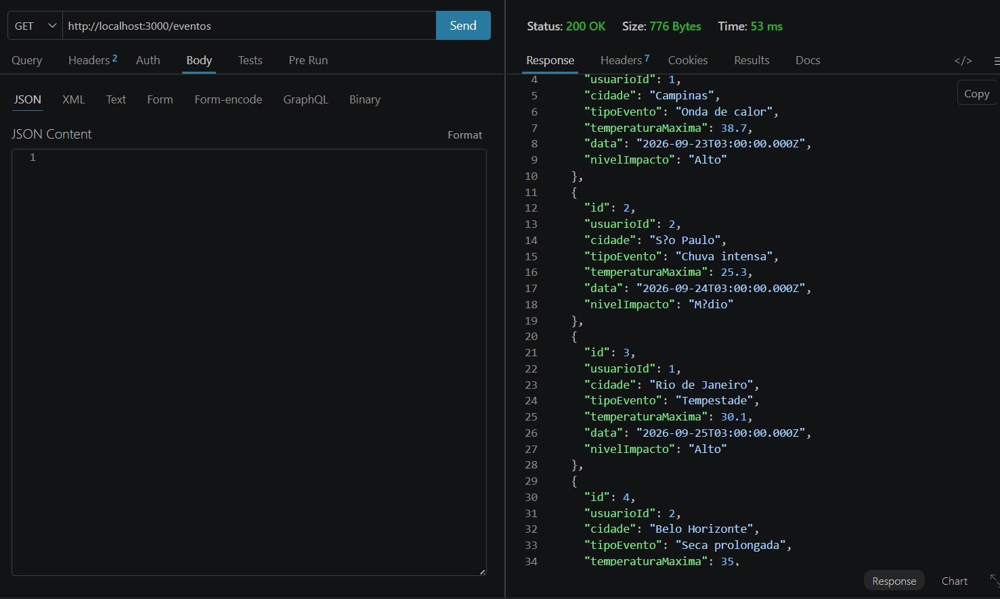
## Prints dos testes de atualizar usuário
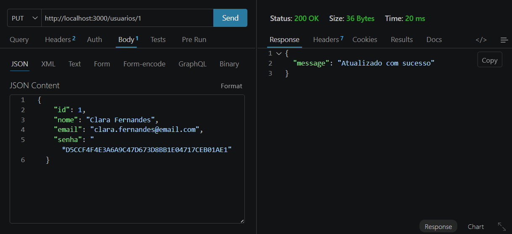
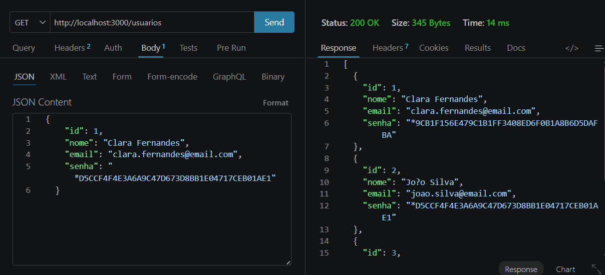
## Prints dos testes de atualizar evento
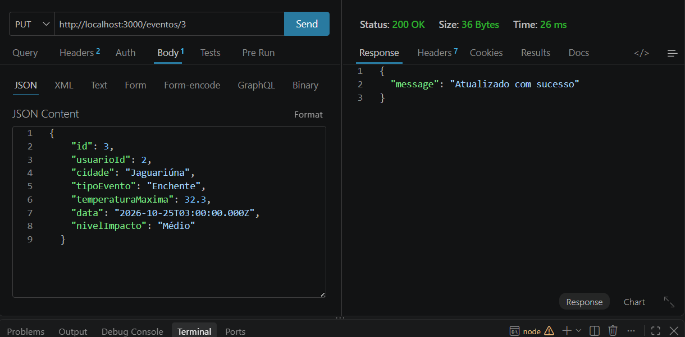
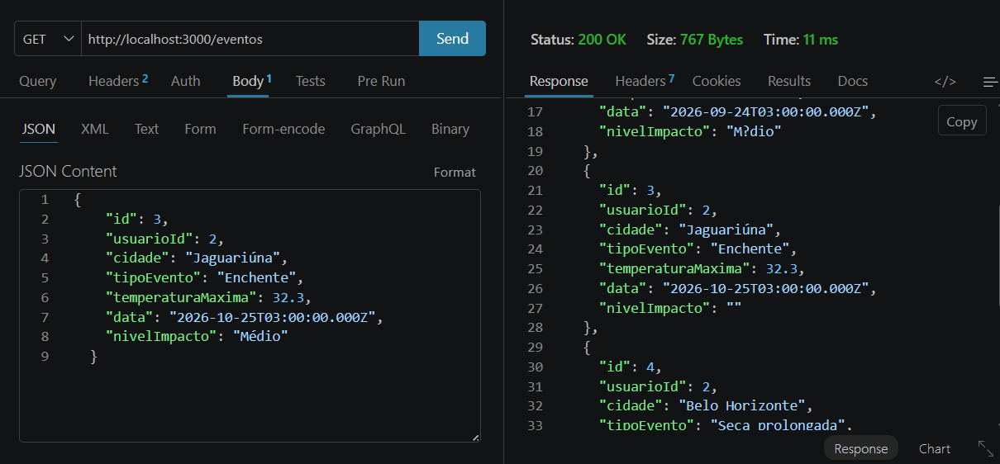
## Prints dos testes de excluir usuário
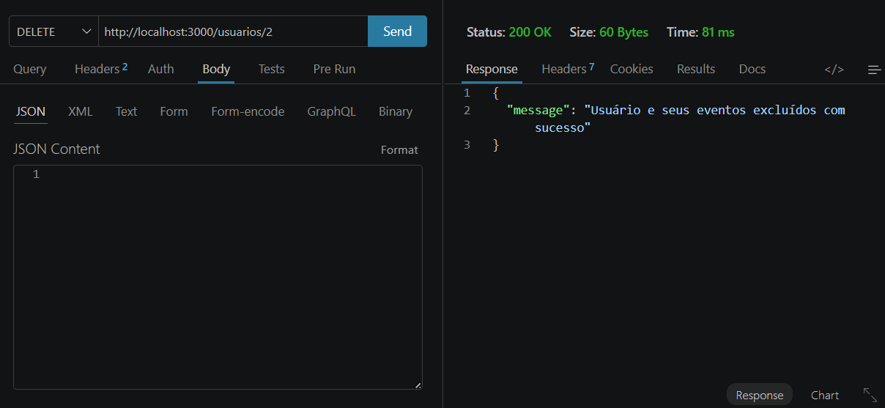
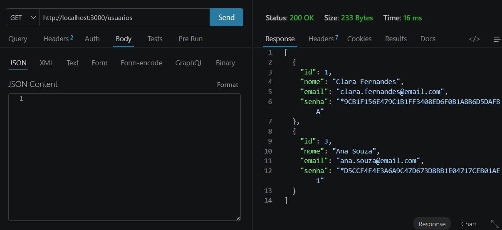
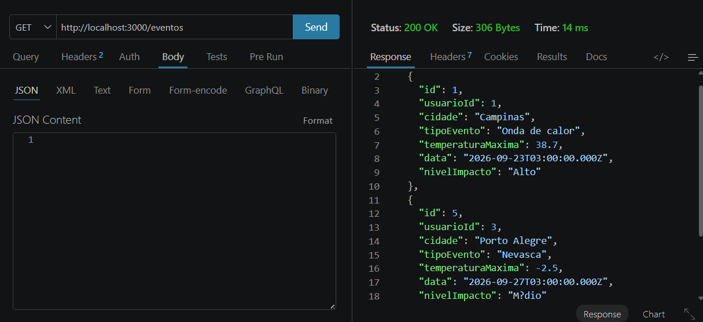
## Prints dos testes de excluir evento
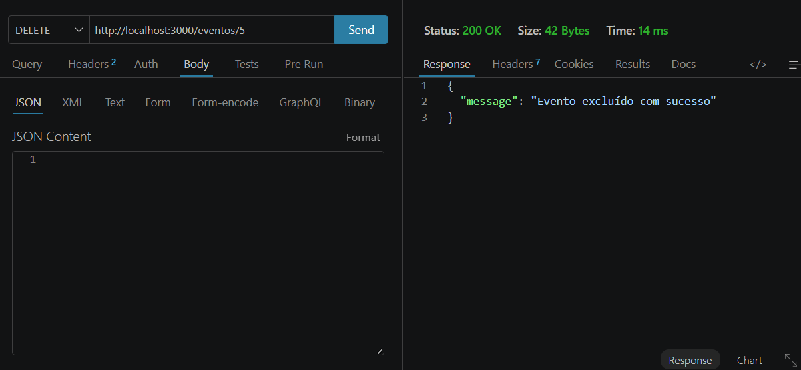
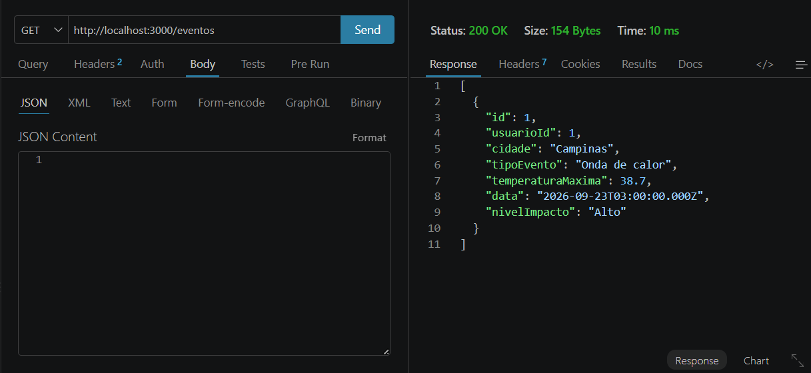
## Prints dos testes de resumo
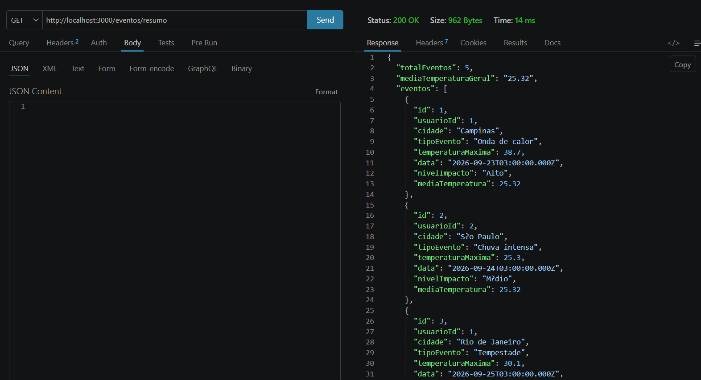
## Prints dos testes de login
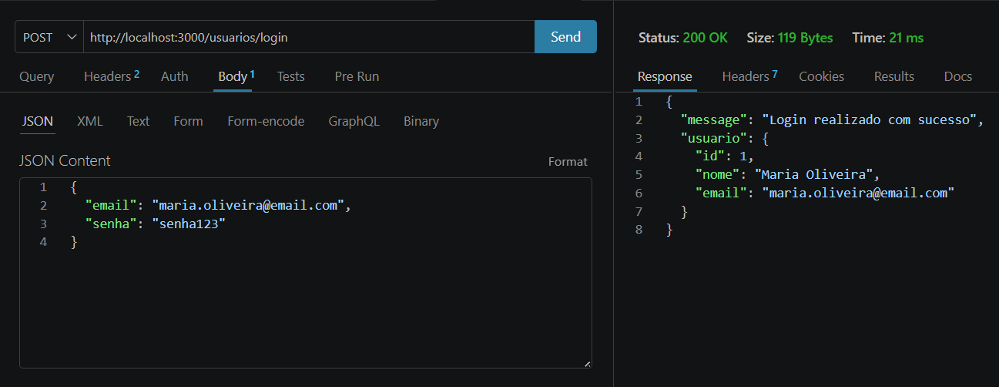
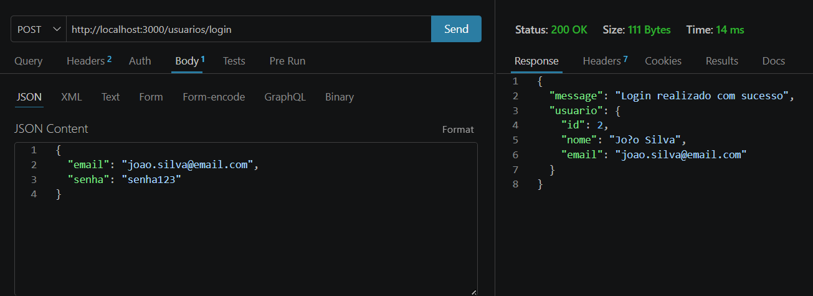
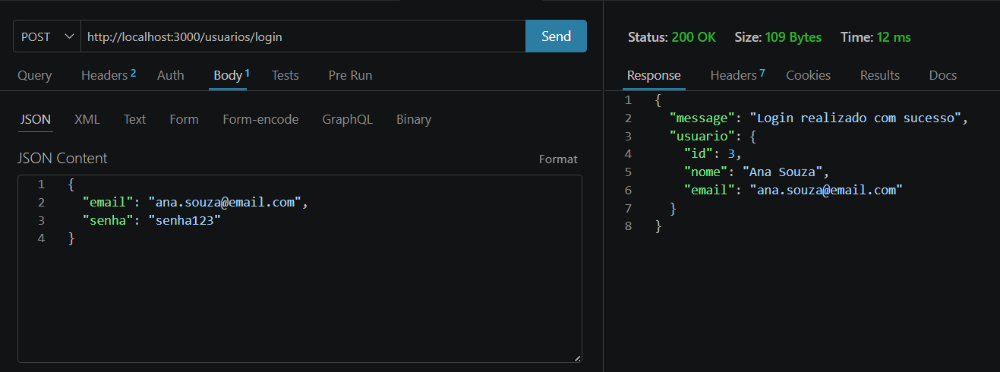
